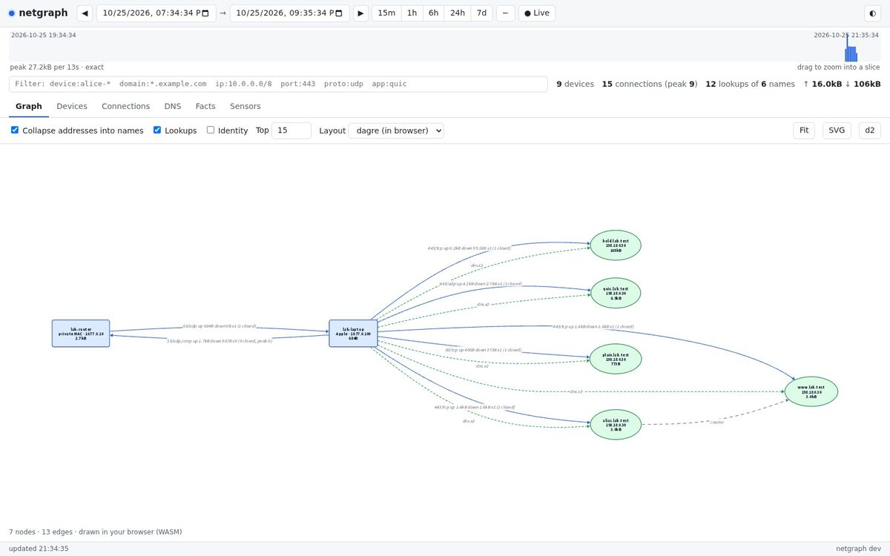

# netgraph

Passive visibility for a home or lab network, as a graph you can slice by
time.

A small sensor on your router watches the LAN and learns what it can
without being told: which devices are there (DHCP, mDNS/DNS-SD, NetBIOS,
LLMNR, SSDP/UPnP, LLDP, ARP/NDP, reverse DNS, MAC vendors), what they look
up (DNS, with answers and TTLs), and what they talk to (connections with
bytes each way, TLS and QUIC server names, ALPN, JA4 fingerprints, HTTP
hosts and user agents). With a monitor-mode wireless interface it also sees
Wi-Fi networks and their clients, and can decrypt open, WEP, WPA and WPA2
traffic when the keys are supplied. It ships all of it to a netgraph
server, which keeps it in SQLite as **entities and relationships over
time**, and, given an ASN table, names the network and country of every
remote address.

For any window `t0 → t1` you can ask:

- which devices were on the network, and what they are called
- what each one looked up, and what those names resolved to (and for how long)
- which hosts each device **was already connected to** when the window opened,
  which it **connected to during** the window, and which connections **closed**
- how many connections were open at once, and how much data moved inside the
  window (connections straddling its edges count only their share)
- which ports, protocols and applications were used

You get the answers as tables, as a graph in the terminal, or as a graph in
the browser.



## Components

| Binary | Runs on | Does |
|---|---|---|
| `netgraph-sensor` | the router: any Linux, x86, ARM v5–v8, MIPS (softfloat), RISC-V, ppc64le | captures with pure-Go AF_PACKET, decodes (Ethernet or monitor-mode 802.11), ships compressed batches; about 8 MB, about 45 MiB of memory at 64k tracked connections |
| `netgraph` | any host: Linux, macOS, Windows | ingest, SQLite storage and correlation, `query`, `graph`, `tui`, the web UI, `import` for pcap files |

Both are static binaries with no C dependencies.

## Quick start

**See it with demo data** (no capture needed):

```sh
make demo        # generates a home-network capture, imports it, serves http://127.0.0.1:8443
```

**On a router or Linux box** that forwards your LAN:

```sh
# on the server
export NETGRAPH_TOKEN=$(openssl rand -hex 32)
netgraph serve -db /var/lib/netgraph/netgraph.db -listen :8443

# on the router (needs CAP_NET_RAW)
NETGRAPH_TOKEN=... netgraph-sensor run -iface br-lan -server http://netgraph.lan:8443
```

**With Docker**, as a sidecar to a container you want to watch:

```sh
export NETGRAPH_TOKEN=$(openssl rand -hex 32)
docker compose -f deploy/compose/sidecar.yml up -d
```

Then open `http://<server>:8443/`, or use the terminal:

```sh
netgraph tui -server http://netgraph.lan:8443
netgraph query devices -from -24h
netgraph query flows -from '2026-10-25 14:00' -to '2026-10-25 15:00' -device alice-iphone
netgraph graph -from -1h -o window.svg
```

## Documentation

- [Deployment](docs/deployment.md): routers (OpenWrt, generic Linux),
  Docker (sidecar, host, server), packages, TLS and tokens, sizing.
- [Using netgraph](docs/usage.md): the CLI, the TUI and the web UI.
- [Concepts](docs/concepts.md): the data model, how time windows work,
  how names and devices are correlated, and what netgraph cannot see.
- [HTTP API](docs/api.md): query endpoints and the sensor event format.
- [Development](docs/development.md): building, testing, fuzzing, the
  Docker lab, releases.

## Status

netgraph is new. Its tests replay synthetic captures built from real
protocol implementations, compare JA4 fingerprints against Wireshark's,
and run a home network in Docker containers with real daemons (dnsmasq,
avahi, Samba, lldpd, curl, quic-go). It has not yet run on a wide range
of real routers; reports are welcome.

## License

MIT
