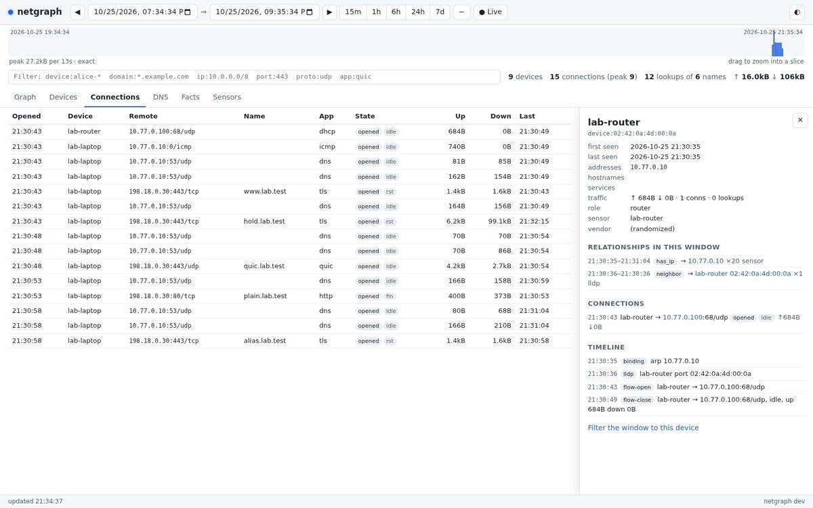
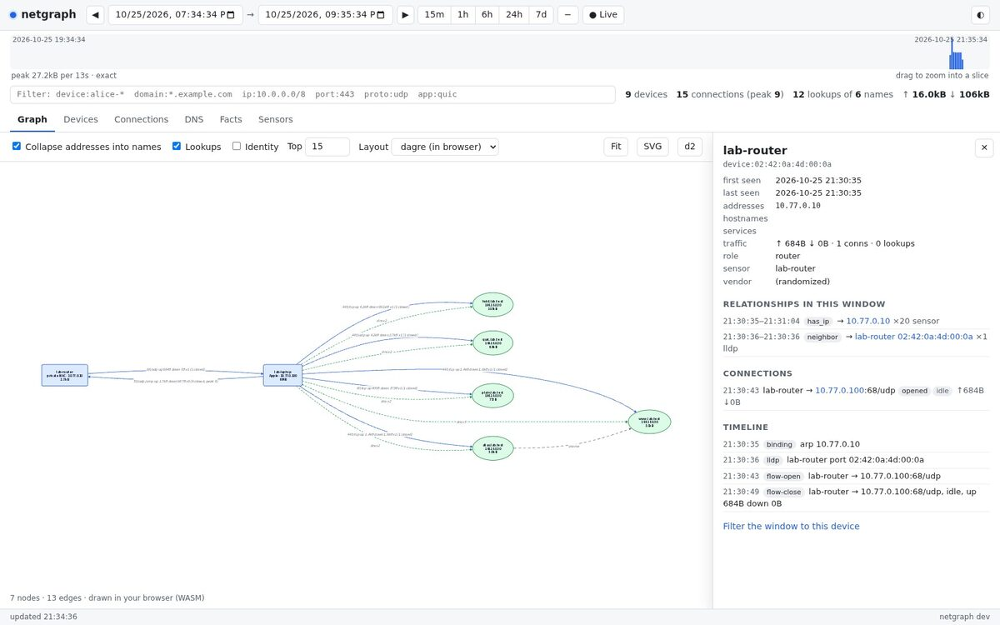

# Using netgraph

Everything here is a view of one **time window** `[from, to)`. The CLI, the
TUI and the web UI ask the same questions over the same API. The CLI and
TUI can also open a database file directly.

## Choosing a window

`-from` and `-to` (and the API's `from`/`to`) accept:

| Form | Example |
|---|---|
| relative to now | `-15m`, `-2h`, `-7d`, `-1w` |
| named | `now`, `today`, `yesterday` |
| local time | `2026-10-25 14:00`, `2026-10-25` (midnight) |
| RFC 3339 | `2026-10-25T14:00:00Z` |
| unix milliseconds | `1792929600000` |

The default is the last hour. Windows older than raw retention (14 days)
or longer than `-exact-max` (48 h) are answered from hourly rollups. Their
edges are then whole hours, and results say `precision: hour`.

Filters narrow any query:

| Flag | Matches |
|---|---|
| `-device` | a device's MAC, label or any hostname it had (glob: `alice-*`) |
| `-ip` | an address or CIDR on either side |
| `-domain` | a DNS name, TLS SNI or HTTP host (glob; a plain word matches as a substring) |
| `-port`, `-proto`, `-app` | the server's port (the service); `tcp`/`udp`/`icmp`; `tls`, `quic`, `http`, `dns`, ... |
| `-dir` | `out` (devices connecting out), `in` (connections from outside to a server here), `local`, `external` |
| `-asn`, `-cc` | the remote end's network (`13335` or `AS13335`) and country (`DE`); needs the server's [ASN table](deployment.md#networks-and-countries) |
| `-multicast` | include multicast and broadcast traffic (hidden by default) |
| `-limit`, `-offset` | page a result: at most `limit` rows, skipping `offset` |

## The CLI

Queries go to `-server` (`$NETGRAPH_SERVER`, with `$NETGRAPH_READ_TOKEN`)
when it is set, and otherwise open `-db` (`$NETGRAPH_DB`, default
`netgraph.db`) read-only. Opening the file is safe while a server writes
to it.

```console
$ netgraph query summary -from -1h
WINDOW             2026-10-25 15:48:34 → 2026-10-25 16:48:34
precision          exact
devices            6
connections        11
  inbound          0
peak concurrent    4
dns queries        5
names              5
remote addresses   7
bytes sent         6.7kB
bytes received     57.9kB

$ netgraph query devices -from -1h
DEVICE           MAC                VENDOR          ADDRESSES              HOSTNAMES        SERVES · SERVICES  CONNS  DNS  SENT   RECV
alice-iphone     3c:22:fb:01:02:03  Apple           192.168.1.23           alice-iphone                        7      4    5.9kB  57.6kB
Google aa:bb:cc  f4:f5:d8:aa:bb:cc  Google          192.168.1.50,fd00::50                                      2      1    334B   239B
desktop-1        00:15:5d:01:02:03  Microsoft       192.168.1.60           desktop-1                           1      0    96B    0B
BRN001BA9        00:1b:a9:44:55:66  Brother         192.168.1.40           BRN001BA9.local  Office Printer     0      0    0B     0B
core-switch      00:1b:21:aa:00:01  Intel [switch]                                                             0      0    0B     0B

$ netgraph query flows -from -1h -device alice-iphone
OPENED               DIR  CLIENT        SERVER                 NAME              APP   STATE                   SENT   RECV    LAST
2026-10-25 16:38:35  out  alice-iphone  93.184.216.34:443/tcp  www.example.com   tls   opened,closed:fin       3.2kB  56.1kB  16:40:34
2026-10-25 16:38:39  out  alice-iphone  203.0.113.10:443/udp   quic.example.org  quic  opened,closed:shutdown  2.5kB  1.2kB   16:38:39

$ netgraph query dns -from -1h
TIME                 DEVICE           TYPE  NAME               RCODE     MS    ANSWERS
2026-10-25 16:39:00  alice-iphone     A     lost.example.com   TIMEOUT
2026-10-25 16:38:59  alice-iphone     A     nope.invalid       NXDOMAIN  12.0
2026-10-25 16:38:34  alice-iphone     A     www.example.com    NOERROR   12.0  edge.example.net(300s) 93.184.216.34(300s)
```

| Command | |
|---|---|
| `query summary` | headline numbers |
| `query devices` | devices active in the window, with addresses, names, services, traffic |
| `query destinations` | remote ends aggregated by name/address, with connections, traffic and ports |
| `query flows` | connections, with the bytes each carried **inside** the window and their state (`opened`, `carried`, `closed:fin/rst/idle`); with an ASN table, a NETWORK column names the remote end's |
| `query dns` | lookups, answers, TTLs, response times |
| `query facts` | relationships that held in the window: `has_ip`, `hostname`, `announces`, `resolves_to`, `cname`, `serves`, `fingerprint`, `user_agent`, `upnp`, `neighbor` |
| `query timeseries [-step 5m]` | traffic per step |
| `query entity ID` | everything about one entity (`device:<mac>`, `ip:<addr>`, `domain:<name>`), with a timeline |
| `query sensors` | sensors and their counters (packets, kernel drops, events dropped) |
| `query wifi` | Wi-Fi networks, security, channel and associated clients |
| `query anomalies` | what stands out in the window, most severe first ([anomalies](concepts.md#anomalies)) |
| `query frame -at TIME` | the network at a recorded moment, with a lookback |
| `query timeline` | the event rail: device joins, DNS, flow opens/closes, observations |
| `query story ID` | one entity's intervals, milestones and evidence |
| `query diff -at-a ... -at-b ...` | what changed between two moments |
| `whatif -policy FILE` | test a proposed policy against observed traffic; read-only |
| `archive list -dir DIR`, `archive read -dir DIR` | what the long-term archive holds, and its rows as JSON lines |
| `policy learn -device MAC` | propose the least a device needs, from what it did in the last two weeks |
| `policy export -policy FILE -format nftables` | write `nftables`, `openwrt` or `opnsense` configuration for you to apply |
| `ask "question"` | answer from recorded evidence; prints claims and citations |
| `query exposure` | reachable/weak findings, from recorded evidence |
| `query coverage` | which sensors saw which devices |
| `query airspace` | Wi-Fi APs, clients, channels and rogue flags |
| `query weather` | observed traffic and a simple forecast |
| `note "text" -at TIME` | add a note to the recorded moment |
| `bookmark "name" -at TIME` | mark a moment |
| `incident list/show/autopsy/export/resolve/acknowledge/reopen/note/delete` | work with saved investigations |
| `graph -o FILE` | the window's graph: `.svg`, `.d2`, `.txt`, `.json`, or `-` for text on stdout |
| `label MAC NAME...`, `label -clear MAC` | name a device by hand; it overrides DHCP, mDNS and every other source until cleared. With `-server` it goes through the API; without, it writes the database file (stop the server first) |
| `import FILE.pcap...` | ingest captures directly (re-importing a file is a no-op) |
| `db migrate`/`backup`/`retain`/`vacuum` | maintenance |
| `db timeline -since -14d` | rebuild the Flight Recorder event index from existing raw data |
| `db purge BEFORE` | delete everything older than `BEFORE` now, including notes, bookmarks and finished incidents, whatever the retention settings; `-dry-run` reports the counts only |
| `db forget MAC` | remove one device and everything attributed to it (connections, lookups, facts, rollups, rail events, the notes, bookmarks and incidents that name it, private address entities, Wi-Fi sync records); `-dry-run` previews it |
| `db enrich -asn-file FILE` | look up the network of connections stored without an [ASN table](deployment.md#networks-and-countries) |
| `netgraph-sensor check` | preflight an interface, `CAP_NET_RAW`, link type and server authentication |

Add `-o json` or `-o csv` to any `query` for scripts.

`graph` options: `-collapse` (default on; fold addresses into the names
they were reached by), `-sites` (default on; one node per registrable
domain), `-networks` (default on; with an ASN table, one node per network
for clients from outside and unnamed destinations), `-anomalies` (default
on; outline what medium and high anomalies are about), `-top N` (each device's busiest N destinations, `-1` for all; the
rest are one "N more destinations" node), `-dns` (lookups and answers,
default on), `-identity` (services, Wi-Fi networks, and the hostnames,
addresses, fingerprints and vendors devices share), `-layout
elk|dagre`, `-theme light|dark`, `-ascii` (no box-drawing characters).

## Building a policy

Under **Findings → Policy**, or from any connection on the map: right-click an edge or open it,
and choose **Allow** or **Deny**. Each click adds a rule, ahead of the ones before, and shows
straight away what would stop in the current window. The draft lives in your browser.

**Learn** proposes a least-privilege policy for one device from what it did, two weeks by default:
everything it did is allowed and the rest denied. It's a starting point. Something it does
monthly isn't in it, so run it past the window you trust and read the rules.

**Export** writes configuration for nftables, OpenWrt or OPNsense. netgraph never applies it. A
firewall works in addresses, so:

- Devices are matched by the addresses seen for them, so give them fixed leases first.
- Rules naming a site, network or country use the addresses seen for it in the window. Those
  change, and any not seen aren't covered, so a deny by name is weaker than it reads.
- Anything that can't be expressed is commented out and listed as a warning. Read these: a
  left-out deny is traffic that's still allowed.
- DNS rules aren't exported: put them on your DNS server.
- It covers traffic the router forwards. Two devices on one LAN talk through its switch, which the
  router's firewall never sees, so it can't stop those.

The nftables output has been loaded by `nft` and tested against real traffic, and the OpenWrt
output compiled by `fw4`. The OPNsense output is checked as XML only: it hasn't been imported
into a real OPNsense, so look it over first.

## What-if policies

`netgraph whatif -policy FILE` and the web UI's What-if dialog replay a
proposed policy over the connections and lookups recorded in the window. It
is a simulation: nothing is ever applied to a firewall, and traffic that
never happened is invisible to it.

```json
{
  "version": 1,
  "zones": [{"name": "iot", "devices": ["label:plug-*", "role:camera"]},
            {"name": "lan", "devices": ["any"]}],
  "defaults": {"egress": "deny", "ingress": "deny", "intra_zone": "allow", "dns": "allow"},
  "rules": [{"name": "updates", "from": "zone:iot", "to": "site:vendor.com", "ports": ["443/tcp"], "action": "allow"},
            {"name": "admin", "from": "zone:lan", "to": "zone:iot", "action": "allow"},
            {"name": "web", "from": "any", "to": "zone:lan", "ports": ["443/tcp"], "action": "allow"}],
  "dns": {"block": ["*.ads.example"], "allow": []}
}
```

A device belongs to the first zone that selects it, by `any`, `device:ID`,
`label:GLOB`, `role:ROLE`, or a bare glob over its name or ID. A device in no
zone is reported as *unknown*, never blocked.

The first rule that matches decides. `from` and `to` follow who opened the
connection, so an inbound connection is *from* the remote end *to* the
device's zone. A device here is selected by `zone:NAME` (or `zone:any`); the
remote end by `site:`, `domain:`, `ip:` (address or prefix), `asn:`,
`country:`, a bare glob, or its zone when it is a device here too. `any`
matches either.

With no matching rule, the default applies: `egress` for connections out and
between two zones, `ingress` for connections in, `intra_zone` inside one zone.
A policy that omits them denies `egress` and `ingress`. An unknown field, an
unknown zone or a malformed selector is an error rather than a rule that
never matches. *Essential* marks blocked DNS, DHCP, NTP and router traffic,
which the network itself depends on. Connections passing through, with neither
end here, are out of scope.

## The TUI

```sh
netgraph tui -server http://netgraph.lan:8443 -from -1h
netgraph tui -db netgraph.db -live
```

```
netgraph  /tmp/ng.db  2026-10-25 18:54:56 → 2026-10-25 20:54:56 (2h)  6 devices · 11 conns (peak 4) · 5 lookups · ↑6.7kB ↓57.9kB
 1 Summary  2 Devices  3 Flows  4 DNS  5 Facts  6 Graph   [collapse dns top 15 outline]
traffic                                                         █▆▂                peak 31.2kB/57s
alice-iphone  (Apple · 192.168.1.23)
├─ connects www.example.com  443/tcp up 3.2kB down 56.1kB x1 (1 closed)  → 93.184.216.34
├─ connects quic.example.org  443/udp up 2.5kB down 1.2kB x1 (1 closed)  → 203.0.113.10
├─ queried quic.example.org  dns x1  → 203.0.113.10
└─ queried www.example.com  dns x1  → 93.184.216.34
   └─ cname edge.example.net  cname
```

| Keys | |
|---|---|
| `tab`, `1`–`6` | Summary, Devices, Flows, DNS, Facts, Graph |
| `[` `]` | shift the window back / forward by half its length |
| `{` `}` | shift by its whole length |
| `-` `+` | zoom out / in |
| `t` | cycle 15m, 1h, 6h, 24h, 7d ending now |
| `n` | end the window now |
| `l` | live: follow now, refreshing every 5 s |
| `/` | filter: `device:alice-* domain:*.example.com ip:10.0.0.0/8 port:443 dir:in proto:udp app:quic` (a bare word is a domain) |
| `x` | clear the filter |
| `enter` | details of the selected row: facts, connections, lookups, timeline |
| Graph: `c` `d` `w` `i` | collapse, lookups, sites, identity |
| Graph: `<` `>` | fewer / more destinations per device |
| Graph: `o` | switch between the d2 diagram and an outline tree |
| Graph: `s` | save the graph as SVG and d2 in the current directory |
| Graph: arrows | pan the diagram |
| `?` | help |

## AI assistants (MCP)

`netgraph mcp` serves netgraph's tools to an assistant over the Model Context
Protocol, on stdin and stdout. They only read. Point it at a database or a server:

```json
{"mcpServers": {"netgraph": {"command": "netgraph", "args": ["mcp", "-db", "/var/lib/netgraph/netgraph.db"]}}}
```

With `-server`, it holds only the read token (`-token-file` or
`$NETGRAPH_READ_TOKEN`). What the assistant reads goes wherever that assistant sends
it, so this is your decision as much as any: device names, addresses, and what they
connect to. Hostnames and DNS names are chosen by whoever's on the network and could
try to give the assistant instructions; the tools can't change anything, and they
tell the assistant to treat them as data.

## The web UI

`netgraph serve` serves it at `/`. If the server has a read token, the
page asks for it once and keeps it in the browser. Over HTTPS or on localhost it
can be installed as an app; only the app's own files are stored, never data from
the API.

It has seven areas, on keys `1` to `7`: **Home**, **Map**, **Devices**,
**Activity** (Connections, Destinations, DNS, Facts), **Findings** (Anomalies,
Incidents, Insights, What-if), **Wi-Fi** and **Settings** (General, Sensors).

- **Home:** where a bare address lands. Whether sensors are reporting, what's new
  since you were last here (a gap of over half an hour starts a new visit, and
  it looks back at most 7 days), who is here, who was busiest in the last hour,
  and the last day's traffic; click a bar to open the map at that moment. "Now"
  means the newest data held, and the page says so when that is not now. With no
  data yet, it shows how to connect a sensor and watches for the first packets.
- **Command palette** (`Ctrl+K`): go anywhere, run any command, find a device, or
  type a time: `yesterday 3pm`, `tuesday`, `2 hours ago`, `last 24h`,
  `2026-10-25 14:00`. A moment opens the hour around it.
- **Pulse** (Activity): new connections and DHCP as sensors deliver them, whatever
  the window. Pause holds lines back; it shows the newest 500 and counts the rest.
- **Passport** (Devices, or "Open its passport" in a device's details): who a device
  is, when it's busy, how this week compares with the last and what's new since,
  from hourly totals. The address bar holds it, so it can be shared.
- **Tables:** past 400 rows only what's near the screen is drawn, so the browser's
  own search finds only those; All CSV has everything. **Columns** chooses what shows, in this
  browser. Sorting Connections by a time or by bytes covers the whole window on the
  server; other columns, and hourly answers, sort the rows loaded.
- **Device types:** each device is classified from what it says about itself: maker,
  names, mDNS services, DHCP and browser fingerprints, UPnP, and ports it answers
  on. "Why this type" shows the signals, since a device can claim anything, and the
  details panel lets you overrule it and set an owner and groups. The map draws the
  type as the icon, and `type:printer`, `owner:alice` and `group:iot` filter
  everything (one device term at a time).
- **Presence** (Devices): when each device moved traffic in the window, by owner.
  It's traffic, not attendance: a phone asleep on the network doesn't show.
- **To confirm** (Devices): a private MAC with the name or services of a known device
  it was never online alongside. Nothing happens until you answer. Yes links them and
  copies the name, owner and groups; history stays under each address, and the
  passport can undo it.
- **Findings:** the checks run every five minutes, and what they find is remembered.
  The Inbox holds each finding once, with why it fired, whether it's usual for that
  device and what you could do. New ones are counted on the tab. Open one to mark it
  seen; acknowledge or resolve it, or say **This is fine**, which stops it being
  reported for that device and that thing (undo it under This window, in Muted findings).
  A resolved finding comes back only for something that happened later, and one
  quiet for a week resolves itself. Findings about one device close together are
  grouped. **This window** still runs the checks over whatever window you've chosen.
- **Ask** (`?`): answers from the record, with no model involved, and every claim
  cites what it came from. It reads times (`yesterday`, `at 3pm`, `tuesday`, `last 3
  hours`, `2 hours ago`) in your timezone, device types and owners (`the printer`,
  `alice's devices`), rankings (`biggest uploader`, `top sites`), `who's home`, `new
  devices`, `what changed` and `any anomalies`, and two questions joined by `and`.
  It says what it couldn't read, and shows a small map when the answer is about one device.
- **Ask with a model** (only if the server has `-llm-file`): a checkbox in Ask, off
  each time the page loads. For a model off your network it asks first, and shows
  what's being sent. The model can only read, and a statement that doesn't cite a
  read it made is removed. That shows where a claim came from, not that it's right.
- **Privacy mode** (Settings, or the palette): for screenshots and demos, names and
  addresses become consistent stand-ins across the whole page, in this browser. Everything
  still works. Notes and fingerprints are hidden, and exports straight from the server are
  off. Makers, device types, traffic volumes and times stay. It recognises addresses by shape and names by where they appear, so it's best
  effort: check before sharing. A chip in the header says when it's on.
- **Internet** (Activity): "is it me or the ISP?" A sensor on the router sees both legs
  of each TCP handshake, so it can tell the way upstream from the way to your devices.
  It compares upstream with the week before, and shows packets sent again, DNS and
  outages (minutes with several attempts outward and none answered), with a plain verdict.
  It's delay and loss, not speed, and a slow site reads the same as a slow line. Anywhere
  other than the router, "upstream" and "here" mean less. Ask answers "why is it slow?" from this.
- **Settings:** theme, saved views, the commands to add a sensor to this server, what this
  browser remembers, and what the server holds.
- **Window:** pick presets, type times, shift with ◀ ▶ or `[` `]`, or drag
  across the traffic timeline to zoom into a slice. **Live** follows now
  and refreshes as sensors deliver.
- **Filter:** the same syntax as the TUI. Press `/` and it suggests keys, values
  and devices; each term becomes a chip you can remove. **Save view** keeps the
  view, filter, map options and window length in this browser, under Saved views
  and in the palette. A saved view opens as that length up to now.
- **Find** (`f`): devices by MAC, name or label, addresses, DNS names and
  networks, as you type; Enter or a click opens the details.
- **Map:** devices, the names they looked up and reached, where those
  pointed, and the clients that connected in to them (see [the
  graph](concepts.md#the-graph) for how it stays readable). Every
  connection points from client to server, labelled with the server's port;
  "How to read the map" under it has the legend. Width is volume, and dots flow
  along an edge to show direction and rate.

  The map keeps its places. The router sits in the middle with the devices
  around it and what they talk to outside them, and a node stays where it is
  across windows and refreshes, so what changes on the map is what changed on
  the network. **Re-arrange** lays it out again.

  Drag empty space to pan and scroll to zoom. Click a node for its details and
  an edge for its connections. Drag a node to pin it there for everyone who
  uses this server. Shift-drag selects several nodes, to hide or unpin them.
  Right-click anything for what you can do with it, including asking what
  would happen if an edge were blocked. Double-click "N more destinations" or a
  site to open it in place, and again to close it.

  With the map focused, arrow keys move between nodes, Enter opens one, `+` and
  `-` zoom and `0` fits. A list of the same nodes follows the map for screen
  readers.
- **Connections:** each connection's direction (`out`, `in`, `lan`), client
  and server with the server's port, and what the device sent and received.
  Download this view as a PNG, or the graph as SVG or a d2 script, which the
  server draws with the same d2 code as the CLI. While the next window is
  fetched, the current map stays visible under a small spinner. Anomalies
  outline the map when their checks finish, so it never waits for them.
- **Recorder:** moves through time on the map. Drag the head and the map
  answers at once, because the timeline's whole stretch was fetched ahead of
  time; nodes keep their places, and what was quiet at that moment is ghosted.
  Tables and the summary catch up when the head stops. The track shows where the
  traffic is, marks new devices, notes, bookmarks and anomalies, and shades what
  only hourly rollups can answer. Scroll on it to zoom. **⏮ ⏭** jump between
  marks, **Loop** repeats a stretch, and **Diff A**, then **Diff B**, colours the
  map by what was added, removed or much busier between two moments. **Capsule**
  downloads one HTML file that replays the window offline, with no server.
- **Anomalies:** what stands out in the window, most severe first, with the
  evidence ([what is checked](concepts.md#anomalies)). The details panel
  can mute that finding for an hour; mutes are stored on the server and
  also suppress matching webhook alerts. The summary bar
  counts them and opens the tab. Click one to see it on the graph, filtered
  to the address, network or device it is about, with its evidence at the
  top of the details. On the graph, medium and high ones outline their
  device and destination, and a marked node's details start with why.
- **Tables:** devices, connections, DNS, facts, Wi-Fi networks and
  sensors. Click a row for details, and a column's header to sort by it
  (again to reverse, a third time for the table's own order). Connections,
  lookups and facts stop at the API's default number of rows (1000, 500
  and 2000); the bar above the table says so and **Load more** fetches the
  next page and appends it. **CSV** downloads the rows as shown and **All
  CSV** streams every matching row in the window, every field the API
  returns, with times in ISO 8601; text that a spreadsheet would run as a
  formula (including after leading whitespace) is prefixed with `'`. The Wi-Fi table lists only networks reported by a
  monitor-mode sensor; it stays empty on an Ethernet-only deployment.
- **Links:** the address bar holds the window, filter, view, graph options,
  a table's sort and the details that are open, so a copied link shows the
  same view. A link with a window and no view opens the map, as it always did.
- **Details:** an entity's relationships in the window, its connections,
  and a timeline merging DHCP, mDNS, ARP/NDP, lookups and connections
  opening and closing. A device's panel has a **Rename** box: your name
  replaces the automatic one everywhere (the devices table still shows the
  automatic name under it), and **Use “…”** puts the automatic name back.
  Renaming and muting need the read token, like the rest of the UI. If a
  token is missing or rejected, the footer shows **Connect**; the dialog
  is shared by all in-flight requests and can be reopened without a reload.

The window and filter live in the URL, so a link reproduces a view.



