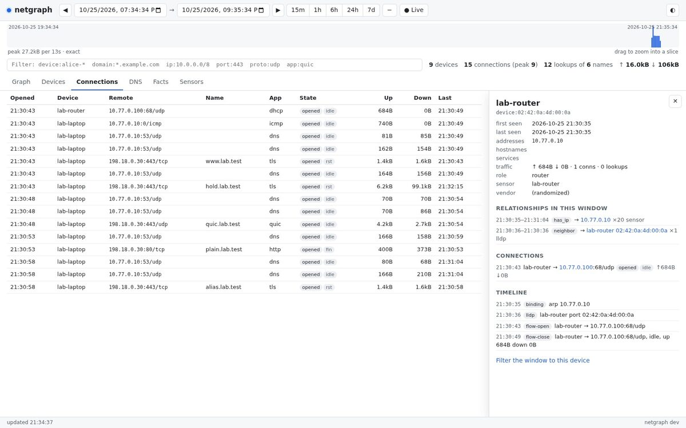
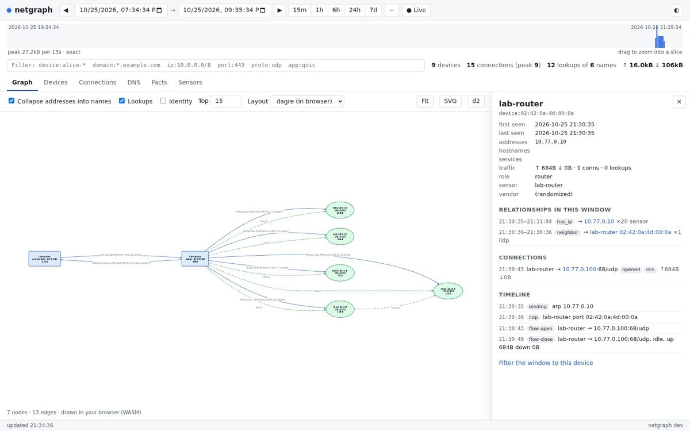

# Using netgraph

Everything here is a view of one **time window** `[from, to)`. The CLI, the
TUI and the web UI ask the same questions over the same API. The CLI and
TUI can also open a database file directly.

## Choosing a window

`-from` and `-to` (and the API's `from`/`to`) accept:

| Form | Example |
|---|---|
| relative to now | `-15m`, `-2h`, `-7d`, `-1w` |
| named | `now`, `today`, `yesterday` |
| local time | `2026-10-25 14:00`, `2026-10-25` (midnight) |
| RFC 3339 | `2026-10-25T14:00:00Z` |
| unix milliseconds | `1792929600000` |

The default is the last hour. Windows older than raw retention (14 days)
or longer than `-exact-max` (48 h) are answered from hourly rollups. Their
edges are then whole hours, and results say `precision: hour`.

Filters narrow any query:

| Flag | Matches |
|---|---|
| `-device` | a device's MAC, label or any hostname it had (glob: `alice-*`) |
| `-ip` | an address or CIDR on either side |
| `-domain` | a DNS name, TLS SNI or HTTP host (glob; a plain word matches as a substring) |
| `-port`, `-proto`, `-app` | remote port; `tcp`/`udp`/`icmp`; `tls`, `quic`, `http`, `dns`, ... |
| `-multicast` | include multicast and broadcast traffic (hidden by default) |

## The CLI

Queries go to `-server` (`$NETGRAPH_SERVER`, with `$NETGRAPH_READ_TOKEN`)
when it is set, and otherwise open `-db` (`$NETGRAPH_DB`, default
`netgraph.db`) read-only. Opening the file is safe while a server writes
to it.

```console
$ netgraph query summary -from -1h
WINDOW             2026-10-25 15:48:34 → 2026-10-25 16:48:34
precision          exact
devices            6
connections        11
peak concurrent    4
dns queries        5
names              5
remote addresses   7
bytes up           6.7kB
bytes down         57.9kB

$ netgraph query devices -from -1h
DEVICE           MAC                VENDOR          ADDRESSES              HOSTNAMES        SERVICES        CONNS  DNS  UP     DOWN
alice-iphone     3c:22:fb:01:02:03  Apple           192.168.1.23           alice-iphone                     7      4    5.9kB  57.6kB
Google aa:bb:cc  f4:f5:d8:aa:bb:cc  Google          192.168.1.50,fd00::50                                   2      1    334B   239B
desktop-1        00:15:5d:01:02:03  Microsoft       192.168.1.60           desktop-1                        1      0    96B    0B
BRN001BA9        00:1b:a9:44:55:66  Brother         192.168.1.40           BRN001BA9.local  Office Printer  0      0    0B     0B
core-switch      00:1b:21:aa:00:01  Intel [switch]                                                          0      0    0B     0B

$ netgraph query flows -from -1h -device alice-iphone
OPENED               DEVICE        REMOTE                 NAME              APP   STATE              UP     DOWN    LAST
2026-10-25 16:38:35  alice-iphone  93.184.216.34:443/tcp  www.example.com   tls   opened,closed:fin  3.2kB  56.1kB  16:40:34
2026-10-25 16:38:39  alice-iphone  203.0.113.10:443/udp   quic.example.org  quic  opened,closed:shutdown  2.5kB  1.2kB   16:38:39

$ netgraph query dns -from -1h
TIME                 DEVICE           TYPE  NAME               RCODE     MS    ANSWERS
2026-10-25 16:39:00  alice-iphone     A     lost.example.com   TIMEOUT
2026-10-25 16:38:59  alice-iphone     A     nope.invalid       NXDOMAIN  12.0
2026-10-25 16:38:34  alice-iphone     A     www.example.com    NOERROR   12.0  edge.example.net(300s) 93.184.216.34(300s)
```

| Command | |
|---|---|
| `query summary` | headline numbers |
| `query devices` | devices active in the window, with addresses, names, services, traffic |
| `query flows` | connections, with the bytes each carried **inside** the window and their state (`opened`, `carried`, `closed:fin/rst/idle`) |
| `query dns` | lookups, answers, TTLs, response times |
| `query facts` | relationships that held in the window: `has_ip`, `hostname`, `announces`, `resolves_to`, `cname`, `serves`, `fingerprint`, `user_agent`, `upnp`, `neighbor` |
| `query timeseries [-step 5m]` | traffic per step |
| `query entity ID` | everything about one entity (`device:<mac>`, `ip:<addr>`, `domain:<name>`), with a timeline |
| `query sensors` | sensors and their counters (packets, kernel drops, events dropped) |
| `query wifi` | Wi-Fi networks, security, channel and associated clients |
| `graph -o FILE` | the window's graph: `.svg`, `.d2`, `.txt`, `.json`, or `-` for text on stdout |
| `import FILE.pcap...` | ingest captures directly (re-importing a file is a no-op) |
| `db migrate`/`backup`/`retain`/`vacuum` | maintenance |

Add `-o json` or `-o csv` to any `query` for scripts.

`graph` options: `-collapse` (default on; fold addresses into the names
they were reached by), `-top N` (each device's busiest N destinations,
`-1` for all), `-dns` (lookups and answers, default on), `-identity`
(hostnames, services, fingerprints and vendors as nodes), `-layout
elk|dagre`, `-theme light|dark`, `-ascii` (no box-drawing characters).

## The TUI

```sh
netgraph tui -server http://netgraph.lan:8443 -from -1h
netgraph tui -db netgraph.db -live
```

```
netgraph  /tmp/ng.db  2026-10-25 18:54:56 → 2026-10-25 20:54:56 (2h)  6 devices · 11 conns (peak 4) · 5 lookups · ↑6.7kB ↓57.9kB
 1 Summary  2 Devices  3 Flows  4 DNS  5 Facts  6 Graph   [collapse dns top 15 outline]
traffic                                                         █▆▂                peak 31.2kB/57s
alice-iphone  (Apple · 192.168.1.23)
├─ connects www.example.com  443/tcp up 3.2kB down 56.1kB x1 (1 closed)  → 93.184.216.34
├─ connects quic.example.org  443/udp up 2.5kB down 1.2kB x1 (1 closed)  → 203.0.113.10
├─ queried quic.example.org  dns x1  → 203.0.113.10
└─ queried www.example.com  dns x1  → 93.184.216.34
   └─ cname edge.example.net  cname
```

| Keys | |
|---|---|
| `tab`, `1`–`6` | Summary, Devices, Flows, DNS, Facts, Graph |
| `[` `]` | shift the window back / forward by half its length |
| `{` `}` | shift by its whole length |
| `-` `+` | zoom out / in |
| `t` | cycle 15m, 1h, 6h, 24h, 7d ending now |
| `n` | end the window now |
| `l` | live: follow now, refreshing every 5 s |
| `/` | filter: `device:alice-* domain:*.example.com ip:10.0.0.0/8 port:443 proto:udp app:quic` (a bare word is a domain) |
| `x` | clear the filter |
| `enter` | details of the selected row: facts, connections, lookups, timeline |
| Graph: `c` `d` `i` | collapse, lookups, identity |
| Graph: `<` `>` | fewer / more destinations per device |
| Graph: `o` | switch between the d2 diagram and an outline tree |
| Graph: `s` | save the graph as SVG and d2 in the current directory |
| Graph: arrows | pan the diagram |
| `?` | help |

## The web UI

`netgraph serve` serves it at `/`. If the server has a read token, the
page asks for it once and keeps it in the browser.

- **Window:** pick presets, type times, shift with ◀ ▶ or `[` `]`, or drag
  across the traffic timeline to zoom into a slice. **Live** follows now
  and refreshes as sensors deliver.
- **Filter:** the same syntax as the TUI.
- **Graph:** devices, the names they looked up and reached, and where those
  pointed. Drag to pan, scroll to zoom, click a node for its details.
  Download the SVG or the d2 script. The graph is laid out in your
  browser by the same Go code as the server, compiled to WebAssembly
  (dagre). The **elk** layout is drawn by the server. While the next
  window is fetched and laid out, the current graph stays visible under a
  small spinner rather than blanking.
- **Tables:** devices, connections, DNS, facts, Wi-Fi networks and sensors. Click a row
  for details. The Wi-Fi table lists only networks reported by a
  monitor-mode sensor; it stays empty on an Ethernet-only deployment.
- **Details:** an entity's relationships in the window, its connections,
  and a timeline merging DHCP, mDNS, ARP/NDP, lookups and connections
  opening and closing.

The window and filter live in the URL, so a link reproduces a view.



